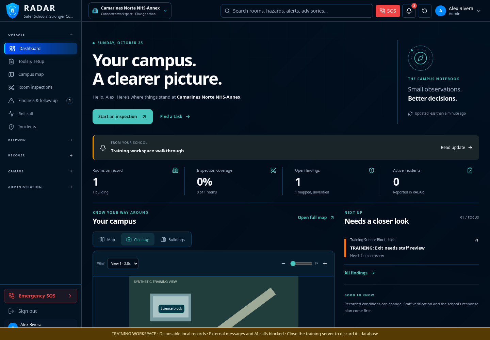
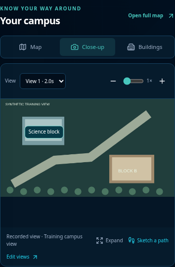
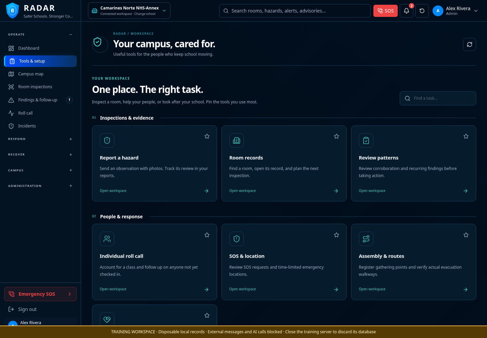
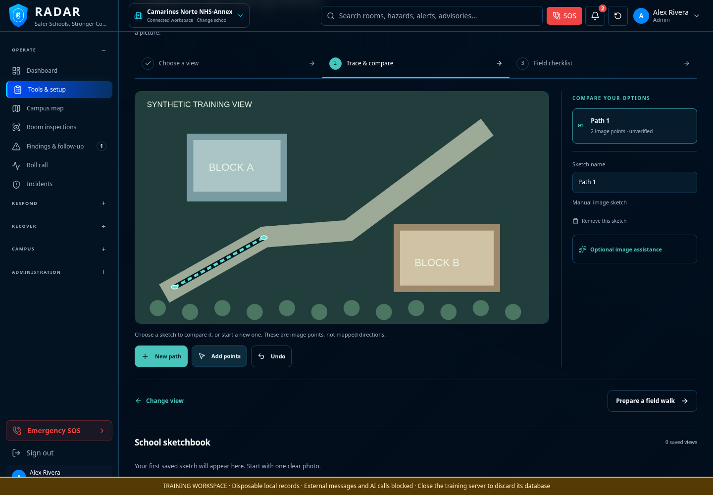

# A clearer RADAR workspace

This refresh replaces the dashboard's repeated panels and the operations page's long tab bars with a smaller overview and a task-based workspace. Existing URLs and records remain available. The screenshots below use **isolated synthetic training records**, not verified campus imagery or conditions.

## Campus desk

Four compact summaries, an actionable focus list, and one campus panel. Switch between **Map**, **Close-up**, and **Buildings** without stacking oversized maps and images. A published campus view is shown by default when available. Actual active incidents or help requests get a prominent response strip; no empty emergency panel is shown.



Recorded imagery fits a bounded viewport and keeps labels aligned with the actual image. Zoom to pan, or choose **Expand** for a native full-screen dialog; Escape closes it. Portrait and landscape images retain their proportions. Map controls stay inside the map rather than floating over navigation.



## Find a task

The sidebar's **Tools & setup** entry opens a searchable library. Tasks are grouped by purpose with a short explanation, not a row of technical tab labels. Search also finds specialist tools such as roster imports, GPS sharing, 3D footprints and device configuration. Pin the tasks you use most. Pins are device preferences, scoped to the signed-in account and selected school; they do not change school permissions.



The sidebar groups less frequent destinations into expandable sections. Phones and smaller tablets get **Today**, **Campus**, **Inspect/Report/Updates** (depending on role), and **Workspace** shortcuts. SOS remains available separately. School location editing is collapsed in the building directory until needed. Secondary operation forms open on demand.

Empty states explain a next step: create a class before importing its roster, start a draft inspection before calibrating evidence, register spaces before making a measured model, and connect a source before expecting occupancy readings. Analytics avoids a screen of zero charts when there is not enough activity for trends. No demonstration measurements are added to a real school to fill the screen.

## Photo Route Studio

Open **Tools & setup → Campus views & more → Photo route studio**, search for it from the workspace, or choose **Sketch a path** on a published close-up view.



1. Choose a permitted photo or a supported video. For video, pause at a clear view and select **Use this frame**. The full video stays on the device. Published campus photos/frames can be opened directly without another upload.
2. Draw up to three candidate paths on the image, undo points, rename sketches and compare them. Keyboard users can enter the drawing canvas, move with arrow keys and place points with Enter. Each sketch needs at least two distinct image points.
3. Prepare a field walk. Check the actual surface, gates, obstructions and destination, and record who observed what and when. Checks need notes. Save to the school's sketchbook or export a field copy. Only the author or a school administrator can update/delete the saved record; staff with sketch-writing permission can save their own copy.

Optional AI assistance can propose clearly visible walkway segments from the chosen photo or video frame. It uses the selected provider only after consent, and returns uncertainties for staff to check. Manual drawing does not require an AI key. The earlier live Gemini timeout remains deferred; the adapter is tested with mock responses, not certified against the user's live project.

**Image sketches are unverified.** They do not supply GPS coordinates, scale, walking times, hidden connections, accessibility clearance or a safety certification. Saving field notes never activates an evacuation route. Approved routing continues to use separately registered, verified real-world walkways and gathering points. All sketch APIs enforce school access, writing permissions, geometry bounds and audit records.

## Update and try it

Stop the older development server, back up real records, then:

```sh
git pull origin design/radar-command-dashboard
npm ci
npm run dev
```

Open the new **Local** URL printed by that launcher. For disposable practice, use `npm run build` followed by `npm run test:lab`; its records/uploads are removed when stopped. Schema updates are additive. Private `.env` settings are preserved and are not part of this update.

## Validation

- 76 automated tests, including route-sketch permissions, ownership, school boundaries, invalid geometry, source kinds and no automatic route activation.
- 32 feature tests against isolated embedded PostgreSQL (not the user's live Supabase project).
- Production build and lint completed; lint reports React advisory warnings and the build reports the existing large Three.js chunk warning.
- Browser checks cover task search/pins, bounded imagery and expansion, photo/video capture, static-photo publication, source-to-sketch links, field checklist/save/export and layouts at 360, 390, 768, 1024 and 1440 pixels, plus a light-theme check. No JavaScript page errors in those scenarios.
- Regression checks cover room QR, offline reopening, photo persistence, explicit outbox sync without automatic reconnect sends, evidence linking, and the SOS hold/cancel interaction.

Physical phone/browser differences, live provider analysis, external imagery availability, production hosting and a live Supabase deployment remain separate acceptance checks. This refresh does not claim those have been activated.
